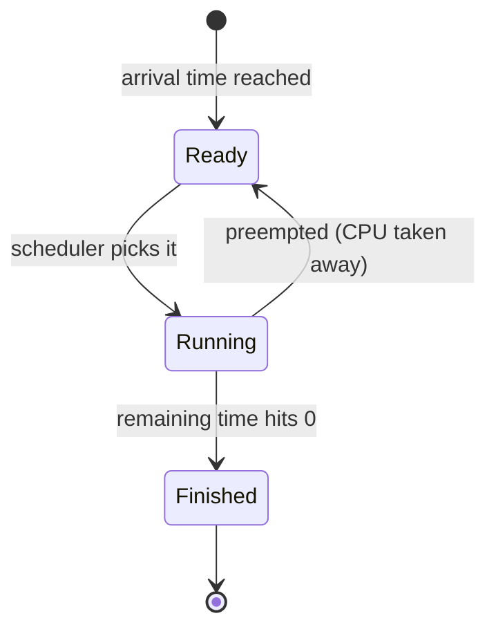

# 01 · CPU Scheduling Basics

*Previous: [README](../README.md) · Next: [02 · SRTF Explained](02-srtf-explained.md)*

---

## 1. The problem: one CPU, many processes

Your computer runs dozens or hundreds of **processes** at once — your
browser, music player, editor, background updaters — but a single CPU core
can execute only **one process at any instant**. The part of the operating
system that decides *who gets the CPU next, and for how long* is called the
**scheduler**. Its decisions are called a **schedule**.

Why not just run each process to completion, one after another? Because
then a 10-minute video encode would freeze your mouse for 10 minutes.
Instead the OS rapidly alternates, giving each process small slices of CPU.
The alternation is so fast that it creates the illusion of simultaneity —
but *the order of the slices still matters enormously* for how the system
feels and how long everyone waits.

**CPU scheduling is the study of how to order those slices.**

### A simplified model

To study scheduling we strip a process down to three facts:

| Fact | Symbol used in this repo | Meaning |
|------|--------------------------|---------|
| Arrival time | `arrival` | The time at which the process appears and wants CPU |
| Burst time | `burst` | The *total* CPU time the process needs to finish |
| Remaining time | `remaining` | `burst` − (CPU time already received) |

Time flows in discrete **units** (also called *ticks*). In each tick exactly
one process runs — or none does. Real processes also do I/O, have
priorities, threads, memory needs... all ignored here. This simplification
is called the **CPU-burst model**, and nearly every operating-systems course
starts with it.

### The life of a process, in this model

- A process in the **ready queue** has arrived and is waiting for the CPU.
- Exactly one process is **running** (or the CPU is **idle** if the ready
  queue is empty).
- A process is **finished** once it has received `burst` units in total.

The simulator in `srtf.py` moves processes through exactly these states,
one tick at a time.

---

## 2. The scheduler's dilemma

Every scheduling algorithm must answer two questions:

1. **Selection** — when several processes are ready, which one runs next?
2. **Preemption** — may the running process be *interrupted* before it
   finishes, and if so, when?

Different answers give the classic algorithms:

| Algorithm | Selection rule | Preemptive? |
|-----------|---------------|-------------|
| **FCFS** (First Come First Served) | Whoever arrived earliest | No |
| **SJF** (Shortest Job First) | Smallest *burst* among ready | No |
| **SRTF** (Shortest Remaining Time First) | Smallest *remaining* among ready | **Yes** — re-decided every tick |
| **Round Robin** | Arrival order, but each gets at most a *quantum* (e.g. 2 ticks) | Yes — on quantum expiry |
| **Priority** | Highest priority (static or dynamic) | Either |

SRTF is best understood as **the preemptive twin of SJF**: SJF asks
*"who needs the least time in total?"* once, when the CPU frees up; SRTF
asks *"who needs the least time **from now**?"* continuously. That single
change — re-asking the question at every tick — is what this repo is about.

---

## 3. Preemption and the context switch

**Preemption** means taking the CPU away from a process that hasn't
finished. The mechanism that does it (saving the victim's registers and
program counter, loading the winner's) is a **context switch**. Context
switches are not free — they consume CPU time doing bookkeeping instead of
useful work — which is why this repo counts them. (Our simulator counts
them but, like most textbook treatments, charges 0 time for them.)

Two very different styles result:

- **Non-preemptive (cooperative):** once started, a process runs until it
  finishes or blocks. Simple, few switches — but one long process can block
  everyone behind it.
- **Preemptive:** the scheduler can interrupt at (nearly) any moment. Short
  jobs are never stuck behind long ones for long — at the cost of more
  switches and more complexity.

> **Analogy.** A single barista (CPU) serving customers (processes).
> FCFS serves whoever queued first, start to finish. SRTF constantly
> asks *"whose drink will be done soonest?"* and works on that one —
> pausing a half-made large order the moment a quick espresso arrives.

---

## 4. What makes a schedule "good"?

There is no single best answer — it depends on what you optimise for:

- **Average waiting time** — how long processes sit ready-but-not-running.
  The classic textbook criterion, and the one SRTF excels at.
- **Average turnaround time** — arrival → finish, i.e. how long users
  perceive a job to take.
- **Response time** — arrival → *first* slice of CPU. Crucial for
  interactive systems: a program that responds instantly but finishes late
  feels fast; one that ignores you for ages feels broken even if it
  finishes at the same time.
- **Throughput** — processes finished per unit time.
- **CPU utilisation** — fraction of time the CPU does useful work.
- **Fairness / starvation-freedom** — does everybody eventually run?

These goals conflict. SRTF optimises the first three aggressively and can
sacrifice the last one (see starvation in [doc 02](02-srtf-explained.md)).
Every formula is defined precisely in [doc 05](05-metrics-formulas.md).

---

## 5. What the simulator does, in one paragraph

`srtf.py` keeps a clock that advances **one tick at a time**. On each tick
it scans all processes, considers only those that have arrived and not yet
finished, picks the one with the smallest remaining time, and lets it run
for exactly one tick (decrementing its remaining time). If nobody has
arrived, the clock still advances — the CPU idles. The loop ends when every
process has finished. Along the way it records when each process first ran
(response), when it finished (finish), and a per-tick log that becomes the
Gantt chart.

That's the entire algorithm. The remaining documents slow it down and look
at each piece properly.

---

## Check your understanding

1. Three processes have arrived and none has finished. One is running.
   How many are *waiting*, and where are they? *(Two — both sit in the
   ready queue. At most one process runs at a time; everyone else who has
   arrived and not finished is waiting by definition.)*
2. In the table above, which algorithms could leave a short job stuck
   behind a long job that started earlier? *(FCFS and SJF.)*
3. Why does re-deciding "who is shortest" only make sense with preemption?
   *(If you can't interrupt the running process, the answer can't change
   anything until it finishes — the "remaining" of others never changes
   while they wait, so you'd get SJF.)*

Next: [02 · SRTF Explained →](02-srtf-explained.md)
