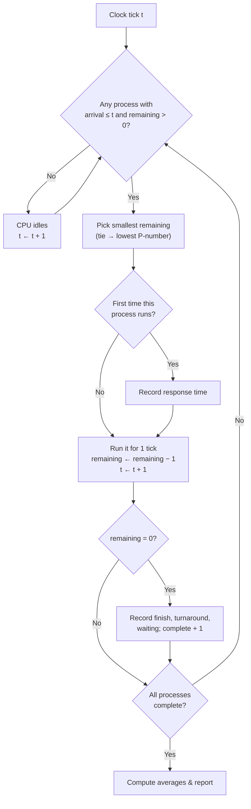

# 02 · SRTF Explained

*Previous: [01 · CPU Scheduling Basics](01-cpu-scheduling-basics.md) ·
Next: [03 · Code Walkthrough](03-code-walkthrough.md)*

---

## 1. The rule

> **SRTF (Shortest Remaining Time First):** at every time unit, run the
> process that (a) has arrived, (b) has not finished, and (c) has the
> smallest remaining time. If several qualify under (c), a tie-break rule
> decides. If none qualify, the CPU idles.

Unpack the three conditions, because each one excludes somebody:

| Condition | Who it excludes | Why it matters |
|-----------|-----------------|----------------|
| arrived (`arrival <= time`) | Future processes | The scheduler can't run what doesn't exist yet — and can't see the future either |
| unfinished (`remaining > 0`) | Completed processes | Obvious, but forgetting this check is a classic bug: finished processes have remaining 0, which "wins" every comparison |
| smallest `remaining` | Everyone else | The heart of the algorithm |

Note what SRTF does **not** look at: not the original burst (a process that
has already run for 9 of its 10 units has remaining 1 and is treated as a
tiny job), not arrival order (except via tie-breaks), not priority.

---

## 2. SRTF in motion — a 10-tick story

Processes: **P1** arrives 0, needs 10 · **P2** arrives 2, needs 1 ·
**P3** arrives 3, needs 2. (Example 4 in `examples.py` — run it!)

| Time | Ready (remaining) | Decision | Why |
|------|-------------------|----------|-----|
| 0–2 | P1 (10→8) | P1 runs | Only process present |
| 2 | P1 (8), P2 (1) | **P2 preempts** | 1 < 8 |
| 3 | P1 (8), P3 (2) | P3 runs | P2 finished; 2 < 8 |
| 5 | P1 (8) | P1 resumes | Alone again |
| 5–13 | P1 (8→0) | P1 runs | Finishes at t=13 |

```text
| P1 (0-2) | P2 (2-3) | P3 (3-5) | P1 (5-13) |
```

Three lessons hide in this tiny example:

1. **Preemption is immediate.** P2 didn't wait for P1 to finish, or even
   for a "quantum" to expire — one tick after arriving it owned the CPU.
2. **Progress is never lost.** P1 resumed at t=5 needing 8, not 10. SRTF
   compares *remaining* times, so past CPU time is never wasted.
3. **Response ≠ finish.** P1's response time is 0 (it ran at t=0) even
   though it finished last. The metrics measure different things —
   [doc 05](05-metrics-formulas.md) untangles them.

---

## 3. Why SRTF is "optimal" — and what that claim really means

**Claim:** for a fixed set of processes with known arrival and burst times,
SRTF minimises the **average waiting time** (equivalently, average
turnaround time, since total burst is constant).

**Intuition (exchange argument).** Look at any schedule that is *not* SRTF.
Somewhere in it, a process with larger remaining time runs while a process
with smaller remaining time waits. Swap one tick: give that tick to the
shorter process instead. The shorter process finishes no later — usually
earlier — and the longer one is delayed by at most that tick, but it wasn't
going to finish before the shorter one anyway. Total waiting across both
does not increase, and typically decreases. Repeating the swap transforms
any schedule into the SRTF schedule without ever making the average worse.
Hence no schedule beats SRTF on this criterion. ∎ (Sketch — a full proof
handles arrivals and ties carefully, but this exchange idea is its core.)

**The caveats matter as much as the claim:**

- "Optimal" means *only* for average waiting/turnaround. It says nothing
  about fairness, response-time variance, or worst-case behaviour.
- It assumes burst times are **known in advance**. Real schedulers must
  guess — [doc 06](06-complexity-limitations-next-steps.md).
- It ignores context-switch cost. A schedule with a switch every tick is
  "optimal" on paper and terrible in silicon.

---

## 4. Tie-breaking: a small rule with visible effects

When two ready processes have **equal remaining time**, who runs? This
simulator uses: **the lowest process number wins** (P1 before P2), because
`_pick_next` uses a strict `<` and therefore keeps the first minimum it
finds. Other valid policies exist (earliest arrival, most-recent runner
stays, round-robin among equals...) and they can change the Gantt chart.

One subtle, guaranteed fact under any "don't switch on ties" policy:
**a running process is never preempted by an equal.** Each tick it runs,
its remaining time strictly decreases, so it stays strictly smallest until
it finishes. Preemption requires a *strictly smaller* newcomer.

*Try it:* `[(0, 3), (0, 3)]` (Example 5) produces `P1 (0-3) | P2 (3-6)` —
no alternation, exactly for this reason.

**Why document something so small?** Because two correct SRTF
implementations can produce two different (both correct) Gantt charts for
the same input. If your hand-traced answer differs from a program's, check
the tie-break rule before assuming a bug — in either.

---

## 5. Idle time: when "shortest" is nobody

If every unfinished process arrives in the future, the ready queue is
empty and the CPU **idles**: the clock advances, nothing runs. The
simulator represents this with `idx == -1` ticks that become `IDLE` blocks
on the Gantt chart (Example 3: `IDLE (0-5) | P1 (5-8) | IDLE (8-10) | ...`).

Idle time is not an error — but it does lower CPU utilisation, and in this
model nothing can prevent it (future processes cannot be run early).
A first process arriving at t=100 guarantees 100 idle ticks no matter how
clever the scheduler is.

---

## 6. Starvation: SRTF's dark side

Because short jobs always jump the queue, a long job can be postponed
**indefinitely** by a steady stream of short arrivals. Run Example 6:

```text
P1(0,12)  P2(1,2)  P3(3,2)  P4(5,2)  P5(7,2)  P6(9,2)

| P1 (0-1) | P2 (1-3) | P3 (3-5) | P4 (5-7) | P5 (7-9) | P6 (9-11) | P1 (11-22) |
```

P1 got 1 tick, then waited **10 ticks** while five short jobs passed it,
and only finished at t=22 (waiting time 10 — everyone else waited 0). If
short jobs kept arriving every 2 ticks forever, P1 would *never* finish.
That is **starvation**, and it's why real systems add defences SRTF lacks:

- **Aging:** the longer a process waits, the more its effective priority
  rises, until it eventually wins.
- **Multilevel feedback queues:** processes move between queues with
  different rules, guaranteeing eventual service (what real OSes use).

Average waiting time can look *excellent* (1.67 above!) while one process
suffers terribly — a first lesson in why averages hide distributions.

---

## 7. SRTF vs its neighbours, on the same input

Classic example `P1(0,8) P2(1,4) P3(2,9) P4(3,5)` (hand-traced in
[doc 04](04-worked-example.md)):

| Algorithm | Gantt chart | Avg waiting |
|-----------|-------------|-------------|
| SRTF | P1 0–1, P2 1–5, P4 5–10, P1 10–17, P3 17–26 | **6.50** |
| FCFS | P1 0–8, P2 8–12, P3 12–21, P4 21–26 | 8.75 |
| SJF (non-preemptive) | P1 0–8, P2 8–12, P4 12–17, P3 17–26 | 7.75 |

FCFS suffers the **convoy effect**: everyone queues behind P1's long burst.
SJF helps — once P1 finishes it makes good choices — but it cannot undo
P1's head start, because at t=0 only P1 exists and SJF won't preempt when
P2 arrives. Only SRTF escapes the convoy, by preempting. That difference —
7.75 vs 6.50 — is the entire value of preemption, made visible.

---

## 8. Decision flowchart



Notice the loop returns to the *selection* step after every single tick —
that loop-back *is* preemption.

---

## Check your understanding

1. P1(0, 6) is running. At t=2, P2 arrives with burst 4. Does P2 preempt?
   *(P1's remaining at t=2 is 4. Tie — P2 does **not** preempt under the
   no-switch-on-tie behaviour; P1's remaining drops to 3 next tick and it
   stays ahead.)* Verify with the simulator.
2. Can SRTF ever idle while a process is ready? *(No — idling happens only
   when the ready queue is empty.)*
3. A process's remaining time is 1 and it's running. A new process arrives
   with burst 1. Who runs next tick? *(The running one finishes this tick
   first — order within a tick matters; arrivals are considered from the
   next tick. Then the newcomer runs.)*
4. Why is "SRTF = SJF re-decided every tick" a fair summary?

Next: [03 · Code Walkthrough →](03-code-walkthrough.md)
